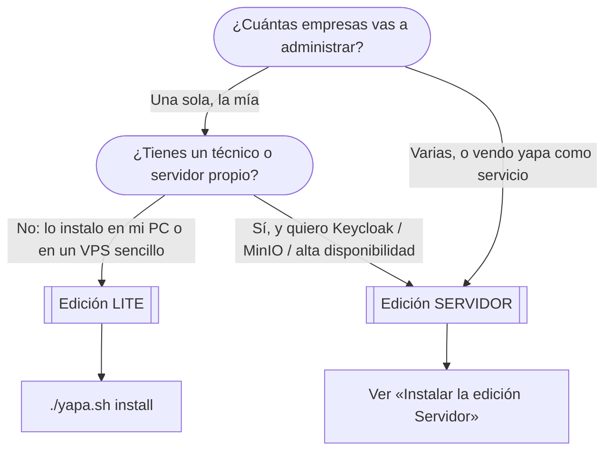

# Lite o Servidor: elige tu edición

yapa tiene **dos ediciones del mismo programa**. Se elige al instalar y se puede pasar de una a otra moviendo una copia de seguridad
(ver [Pasar de Lite a Servidor](#pasar-de-lite-a-servidor); esa ruta aún no se ha probado de extremo a extremo).

## ¿Cuál necesito? (30 segundos)



**Regla simple:** si es *tu* negocio, usa **Lite**. Si eres un estudio contable, un proveedor de software o necesitas
varias empresas aisladas entre sí, usa **Servidor**.

## Comparación

| | **Lite** | **Servidor** |
|---|---|---|
| Empresas | 1 (más una empresa **demo** opcional) | Ilimitadas, cada una con su propia base de datos |
| Para quién | Una pyme, una tienda, un restaurante, un hotel pequeño | Estudios contables, proveedores del servicio, grupos de empresas |
| Inicio de sesión | Integrado en yapa (sin Keycloak) | Integrado **o** Keycloak (SSO, políticas de contraseña) |
| Archivos (PDF, fotos) | Carpeta en disco | Carpeta en disco **o** MinIO / S3 |
| Módulos | **Todos incluidos**, sin contratación | Contratables por empresa (complementos) |
| Operador de plataforma | No hace falta | Sí: da de alta empresas por API |
| Servicios que necesita | Solo **PostgreSQL** (el instalador lo incluye) | PostgreSQL (+ Keycloak y MinIO si los eliges) |
| Memoria recomendada | 2 GB | 4 GB o más, según empresas |
| Instalación | **Asistente `./yapa.sh install`** | Manual / avanzada (receta abajo) |
| Estado de pruebas | Probada de punta a punta con el instalador | Probada por componentes en desarrollo |

> Honestidad primero: el asistente instala **Lite**. La edición Servidor funciona, pero su instalación todavía es
> manual. El panel del operador (alta de empresas) viene en la imagen y se publica con `./yapa.sh admin-panel`
> (ver abajo); el alta por API sigue disponible.

## ¿Dónde puedo instalarlo?

| Entorno | ¿Funciona? | Cómo |
|---|---|---|
| **Windows 10/11** | Sí, con Docker Desktop + WSL2 (sin probar en equipo real) | [Guía de Windows](INSTALAR.md#windows-10--11) |
| **macOS** | Sí, con Docker Desktop | `./yapa.sh install` |
| **Linux (Ubuntu, Debian…)** | Sí, probado | `./yapa.sh install` |
| **VPS en la nube** (Oracle, DigitalOcean, Hetzner…) | Sí, con dominio y HTTPS automático | [VPS](INSTALAR.md#servidor-vps-con-dominio-y-https) |
| **Raspberry Pi / ARM** (Oracle Ampere) | Sí: la imagen es multiarquitectura (amd64 + arm64) | `./yapa.sh install` |

**Antes de instalar, deja que yapa revise tu equipo:**

```bash
./yapa.sh doctor
```

Comprueba Docker, memoria, disco, puertos y `openssl`, y te dice exactamente qué falta.

## Instalar la edición Lite

```bash
./yapa.sh install
```

El asistente te pregunta el nombre de tu empresa, el RUC, el correo y la contraseña del administrador, si quieres
HTTPS con dominio propio y si activas las pruebas de SUNAT. Al terminar muestra todos los accesos.
Detalle en [INSTALAR.md](INSTALAR.md).

## Instalar la edición Servidor

Usa el mismo paquete (`yapa-docker-<versión>.zip`). El asistente instala **Lite** por defecto; con `YAPA_EDITION=server`
instala **Servidor** directamente: genera el `.env` con todas las claves, levanta yapa y, si das un dominio, publica
también el panel del operador.

```bash
unzip yapa-docker-<versión>.zip && cd yapa-docker
YAPA_EDITION=server ./yapa.sh install
```

Pregunta solo el dominio principal (vacío = sin HTTPS, para pruebas) y el dominio del panel del operador
(por defecto `admin.<dominio>`). No crea empresa propia ni demo: al terminar muestra el usuario y la clave del
**operador de plataforma**, que da de alta las empresas desde el panel (abajo). Escribe en `YAPA_CORS_ALLOWED_ORIGINS` los
dos dominios, y `./yapa.sh admin-panel` pide además el usuario y la clave de Basic Auth del panel.

### Instalación manual (alternativa)

Si prefieres escribir el `.env` tú, hazlo **antes del primer arranque** y arranca con `./yapa.sh start`. No ejecutes
`./yapa.sh install` sobre ese `.env`: lo sobrescribiría.

Requisitos previos: Docker con Compose v2, `openssl`, y el DNS de tu dominio (y del subdominio del operador, si lo
usarás) apuntando ya al servidor, con los puertos 80 y 443 abiertos.

```bash
unzip yapa-docker-<versión>.zip && cd yapa-docker
chmod +x yapa.sh seed-demo.sh

DOMINIO=erp.midominio.pe          # dominio del panel de las empresas
ADMIN=admin.midominio.pe          # subdominio del panel del operador (lo publicas después)

umask 077
cat > .env <<EOF
SPRING_PROFILES_ACTIVE=server
YAPA_PUBLIC_URL=https://$DOMINIO
YAPA_DOMAIN=$DOMINIO
YAPA_AUTH_PROVIDER=builtin
YAPA_CORS_ALLOWED_ORIGINS=https://$DOMINIO,https://$ADMIN
DB_PASSWORD=$(openssl rand -hex 24)
SIGNING_MASTER_KEY='$(openssl rand -base64 32)'
YAPA_STORAGE_SIGNING_SECRET=$(openssl rand -hex 32)
YAPA_INTERNAL_SECRET=$(openssl rand -hex 32)
YAPA_OPERATOR_USERNAME=operador
YAPA_OPERATOR_PASSWORD=$(openssl rand -hex 16)
EOF

./yapa.sh start          # levanta PostgreSQL, la aplicación y HTTPS (Caddy)
./yapa.sh status         # espera a que app diga (healthy)
grep -E 'YAPA_OPERATOR|SIGNING_MASTER_KEY' .env     # anota la clave del operador y guarda una copia de la llave
```

Notas importantes:

- **`SIGNING_MASTER_KEY`:** guarda una copia fuera del servidor. Sin ella no se pueden leer los certificados ni las
  credenciales cifradas.
- **`YAPA_CORS_ALLOWED_ORIGINS`:** debe listar **cada** dominio desde el que se abre un panel (el principal y el del
  operador). Sin él, el inicio de sesión responde `403` (ver [INSTALAR.md](INSTALAR.md)).
- **Aplicar cambios del `.env`:** usa `./yapa.sh start`, no `restart` (este no relee el `.env`).
- **Sin demostración:** esta instalación no crea la empresa demo ni una empresa propia. Las empresas las das de alta con
  el operador (abajo). Si quieres la demo, añade `YAPA_DEMO_ENABLED=true` y ejecuta `./yapa.sh seed-demo`.
- **Sin dominio / solo pruebas:** deja `YAPA_DOMAIN` vacío y usa `YAPA_PUBLIC_URL=http://localhost:8080`. No hay HTTPS ni
  panel del operador en dominio propio; el alta de empresas se hace por API.
- **Pasar de Lite a Servidor con datos existentes:** no cambies el `.env` a mano; usa el procedimiento de respaldo de
  la sección "Pasar de Lite a Servidor".

### Panel del operador (recomendado)

Para dar de alta empresas desde la web, publica el panel en un subdominio propio, protegido con Basic Auth:

```bash
# 1. DNS: registro A de admin.midominio.pe hacia la IP del servidor.
# 2. En la carpeta de yapa:
./yapa.sh admin-panel      # pide dominio, usuario y clave de Basic Auth (o la genera)
```

Entra a `https://admin.midominio.pe`, pasa la Basic Auth y luego inicia sesión con el operador
(`YAPA_OPERATOR_USERNAME` / `YAPA_OPERATOR_PASSWORD` del `.env`). Requiere `YAPA_DOMAIN` (HTTPS) y la edición Servidor.

### Alta de empresas por API

Alternativa sin panel:

```bash
TOKEN=$(curl -s -X POST https://erp.midominio.pe/realms/master/protocol/openid-connect/token \
  -d grant_type=password -d client_id=admin-cli -d username=operador --data-urlencode "password=$YAPA_OPERATOR_PASSWORD" \
  | grep -o '"access_token":"[^"]*"' | cut -d'"' -f4)
curl -X POST https://erp.midominio.pe/api/v1/tenants -H "Authorization: Bearer $TOKEN" -H 'Content-Type: application/json' \
  -d '{"slug":"acme","registrationName":"Acme SAC","companyId":"20123456789","countryCode":"PE","fiscalAdapter":"SUNAT","dbHost":"postgres","dbPort":5432}'
```

Al primer arranque yapa crea una empresa técnica llamada `bootstrap` (puedes ignorarla). Cada empresa que des de alta recibe su propia base de datos. Sus usuarios entran con el slug de su empresa en el login.
Para Keycloak, MinIO y todos los demás parámetros, consulta **[CONFIGURACION.md](CONFIGURACION.md)**.

### Borrar una empresa definitivamente (Servidor)

Para eliminar una empresa y **todo** lo que depende de ella (su base de datos propia, usuarios, roles, suscripciones,
credenciales guardadas y notificaciones) y poder volver a crearla con el mismo slug, usa el borrado definitivo. Solo lo
puede hacer el operador de plataforma y **no se puede deshacer**; para evitar accidentes hay que repetir el slug exacto
de la empresa:

```bash
curl -X DELETE "https://erp.midominio.pe/api/v1/tenants/<id-de-la-empresa>?confirmSlug=<slug>" \
  -H "Authorization: Bearer $TOKEN"
```

El `TOKEN` es el del operador (ver "Alta de empresas por API"); el `<id>` aparece en la lista de empresas
(`GET /api/v1/tenants`). La respuesta indica si se borró la base y cuántas filas se eliminaron de cada tabla.

- No existe en la edición Lite (tiene una sola empresa).
- Si no se puede conectar al servidor de bases para borrar la base de la empresa, **no se borra nada** y puedes reintentar.
- **No se borran los archivos subidos** (PDF, fotos) que ya estén en disco o en MinIO: quedan huérfanos y no se vuelven a
  leer. Si usas Keycloak, tampoco se eliminan las cuentas en Keycloak.
- Si prefieres conservar los datos, usa "suspender" o "cancelar" en lugar de borrar.

## Pasar de Lite a Servidor

Tus datos viajan con una copia de seguridad: no se pierde nada.

```bash
./yapa.sh backup                       # en la instalación Lite
# instala la edición Servidor y copia la carpeta backups/<fecha>
./yapa.sh restore backups/<fecha>      # en el Servidor
```

Usa el **mismo `SIGNING_MASTER_KEY`** (viene en `env.backup` dentro del respaldo): sin él no se pueden leer los
certificados ni las credenciales cifradas.
